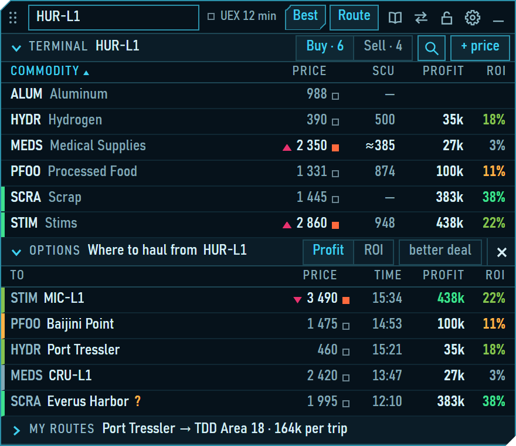

# SC Trade

**English** · [Русский](README.ru.md)

**A personal price diary and trade-route helper for Star Citizen — a small window that stays on top of the game.**
You type in the prices you see at the in-game terminals; SC Trade keeps them, shows how fresh they are and works out which run pays best. [UEX](https://uexcorp.space/) is the reference where you have no prices of your own yet.

- **Download:** [sc-trade.space](https://sc-trade.space) or the [latest release](https://github.com/mob5tertv/sc-trade/releases/latest). Windows 10 / 11, 64-bit. The interface is in English or Russian, chosen at the first start.
- **Next to the game, not inside it:** nothing is injected, the game's memory and files are not read, no key presses or clicks are sent. The only network address is `api.uexcorp.uk`, for the reference data. Hotkeys are optional and none is assigned by default; while one is assigned, Windows calls the program on every key press, and every press is passed on to the game. The window's list of permissions is pinned by a test: [`tests/release/permissions.test.ts`](tests/release/permissions.test.ts). The details: [What the program does not do](#what-the-program-does-not-do).
- **Built with** Tauri 2, Svelte 5, TypeScript and SQLite. How to build it: [Building from source](#building-from-source).
- **Licence:** [MIT](LICENSE). Author: mob5ter — [Twitch](https://www.twitch.tv/mob5tertv).

SC Trade is an unofficial fan-made tool. It is not affiliated with Cloud Imperium Games or Roberts Space Industries and is not endorsed by them.

---

## What the program does not do

- **It does not read the game's memory and injects nothing into other processes.** The code has no call that reads another process's memory or injects code, and it opens no handle of another process.
- **It does not read the game's files.** The window has no permission for the file system; the program opens only its own files — the database, its backups, the database of the demo trip, the log. Its one network address is `api.uexcorp.uk`, for the reference data; other addresses are forbidden to it by its own settings. The window cannot load anything from another address either: its content security policy allows only the program's own files. Both are pinned by tests: [`tests/release/permissions.test.ts`](tests/release/permissions.test.ts) and [`tests/release/csp.test.ts`](tests/release/csp.test.ts). More in [SECURITY.md](SECURITY.md) (in Russian, with a summary in English at the top).
- **It sends no key presses or clicks for the player.** The window gets the keyboard only from your click on a text field or on one of the buttons that open an entry, and gives it back after the entry: `Esc` at once, a click into the game, or by itself after 15 seconds without a key (see [The keyboard](#the-keyboard-how-the-window-takes-it-and-gives-it-back)). If Windows refuses to activate the window, the program asks once and does nothing more.
- **Hotkeys are optional.** None is assigned by default. While at least one is assigned, Windows calls the program's keyboard hook for every key press. For a key that is not assigned the hook returns at once: it does not read the state of `Ctrl`, `Alt` and `Shift` and remembers nothing. Every press is passed on, so the game gets it as usual.
- **The logs hold no titles of other windows, no names or numbers of other processes and no cursor coordinates.** To know whose window is active, the program asks Windows which process owns it and compares that number with its own only; the number is not kept, logged or used to open the process. Cursor watching is a diagnostic, off by default (see [If something goes wrong](#if-something-goes-wrong)).

## What you need

- Windows 10 or 11, 64-bit.
- WebView2: Windows 11 has it; if it is missing, the installer downloads it (internet needed).
- The game in borderless window mode. The window is not drawn over exclusive full screen.
- Internet for the UEX data. Without it the program works on what it has loaded and on your own records.

## Install and first start

1. Run the installer `SC-Trade-1.3.0-setup.exe` (that is the file's name on the site and in the GitHub release). It first asks for its language — the one of Windows is preselected, English if Windows speaks neither — and installs for the current user, without administrator rights, into `%LOCALAPPDATA%\SC Trade` by default; if the program was installed before, it offers the old folder. A Start menu shortcut is made; a desktop shortcut and starting the program are offered on the last page.
2. The file is not signed, so Windows SmartScreen may warn you. Whether to run it is your decision; the checksum is on the site and in the release.
3. The window appears as a mini line in a corner of the screen, with an SC Trade icon in the tray (menu: "Show the panel", "Quit"). The window has no taskbar button. On Windows 11 the icon may be hidden behind the "^" arrow.
4. At the first start the window asks "Язык · Language": one click picks it. You can change it later in Settings → Window → Language.
5. On a new database a demo trip follows: one trip on demo data, from a station to the sale. You press yourself; a hint with an arrow shows where, and the next step opens when you have pressed. The demo runs on its own database (`demo.db`) and does not touch your data. Leave it at any step; repeat it in Settings → Data → Demo trip.
6. Meanwhile the program loads the UEX reference and prices ("Loading UEX reference data…"); the progress is in the header ("UEX 23/57"), and the terminal table fills in as it goes. If the download fails, the window shows the error and a "Retry" button. Later the reference is refreshed at start when it is older than a day, and prices when they are older than an hour; while the program runs, prices refresh every hour.
7. Pick your ship: the end of the demo opens that field, or Settings → Ship and search → Ship (or type "Capacity, SCU" by hand). While the capacity is zero there are no options and no ROI ("Set your ship in the settings"). In the same group: "Star system" and "Budget, UEC".

**To update:** quit the program (tray menu → Quit) and run the new installer. It sees the installed version and offers to uninstall it first or not; your data stays either way — it lives outside the program's folder.

**To remove:** Windows Settings → Apps → Installed apps (Windows 11) or Apps & features (Windows 10). The uninstall window has a box "Delete the application data", unticked by default; ticked, it deletes your database, its backups and the logs too.

## Symbols

Hover the words "Worst", "Time", "rate learned" / "default rate", "Min–max", every "≈" and "Profit": the window explains them in a tooltip, the same way as here.

- **The square next to a price** says whose price it is and how fresh. Filled: your own — red-orange hot, amber warm, light blue cooling, grey-blue cold. Empty with a grey-blue frame: a UEX price. The full label ("mine · 40 min", "UEX · 2 d") is in the opened row; the thresholds are in Settings → Price freshness.
- **A triangle at a price:** your price moved since your previous record — up or down. Green is in your favour (a sale price rose or a purchase price fell), crimson is against you. The tooltip says by how much ("was 2 300 · 2 h ago (+50)").
- **"!" at a price:** the price is far from the UEX history — below half of the lowest or above twice the highest price UEX knows. Check the number.
- **"—" in the SCU column:** the quantity is unknown — no fresh measurement of yours and no UEX data. It does not mean an empty stock: a known zero is written "0".
- **"Min–max":** the lowest and the highest price UEX has for the week; if there is none for the week, for the month, then for all time. "= 5 500" means the price did not change in that period. The table and the options have no column for it: hover a price to see the two numbers.
- **"≈" means an estimate, in three places.** Before a number in the SCU column: the stock estimated by the refill timer from your last measurement ("was 380 · 20 min" in the opened row says which one). In the Trip section ("≈ 66 720", "≈ 14%"): the expected profit and ROI of the trip if the cargo sells at the target at the expected prices; in the mini line, the profit. Before the title of the Options section: the list is preliminary, built on the distances already known while the rest are loading.
- **"rate learned" / "default rate":** the refill rate behind a "≈" stock. Learned — from your own measurements of that terminal and commodity, over the stretches where the stock only grew; default — no such measurements, the largest stock seen divided by "Full stock refill, min" from the settings.
- **The mini line of a trip with one commodity** reads: commodity, quantity, purchase price, an arrow and what is known of the sale price at the target ("MEDS 120 SCU 2 115 → mine 2 351 · 12 min · min 2 190"). A price typed in by a person stands in a frame with "mine" and its age and does not move; after it the "min" and the "max" of the target's sale range take turns in one place. Settings → Window → "Alternate min and max in the mini line" stops the motion: then they stand side by side. With several commodities the line lists them with their purchase prices, and the expected sale price of each is in the tooltip.
- **"Worst"** in an opened option: the profit at the worst prices of the ranges — the purchase at the top of its range, the sale at the bottom of its range. A price of your own has no range, so it is taken as it is; when both prices are yours there is no worst case and a dash stands there.
- **"Time"** in an opened option: the time of the whole trip — the trip itself plus, when the purchase is at another terminal ("better deal"), the empty flight to it. The trip itself is the median of your trips on that pair ("by your trips" in the tooltip), otherwise an estimate from the distance at the quantum speed plus "Overhead per trip, min". A dash means a distance is missing.
- **"Profit"** in the options and in the terminal table: the profit of one trip at the expected prices — what you take (the least of the free hold, the stock at the station and the budget) times the difference of the prices. There is no "UEC per hour": the time of a trip is an estimate, and dividing by it would show a number more exact than it is. You see the profit and the time side by side instead.
- **"?" after an option:** the stock at the purchase terminal is unknown, so the quantity is counted from the hold and the budget only; the real one may be smaller. Such options stand after all those with a known stock.
- **A square with a dot and a number after a commodity** on the Sell side of the terminal table: that commodity is in your hold, the number is how many SCU; such rows come first.

## The window

- **Mini line** — the folded window: one line in a corner of the screen. A click unfolds it; the "minus" in the unfolded window folds it. It also folds by itself after "Collapse after, s" without the cursor over it. Drag it by the grip (the dots on the left); it sticks to the top edge and to the nearer side. The lock next to the settings pins it in place.
- **Header** — the location field (three letters of a station and `Enter`; "I'm here" during a trip), "Best" (the best trips from your location), "Route" (your own pair: from where and to where), the commodity reference (the book), "Changed server", the lock, the settings and the "minus". "UEX 12 min" says how old the prices are; a click refreshes them now.
- **Terminal table** — the commodities of the terminal you look at, on the Buy or Sell side, with the price, the stock (SCU), the profit and the ROI of the best trip with each. A click on a row opens it: price and quantity fields, "Where to sell" / "Where to buy", "Bought", "Sold". "+ price" types in a price you see in the game; the magnifier searches over all the commodities of the terminal ("What to haul here" on the Sell side, "Where to from here" on the Buy side).
- **Price freshness** — a price of your own is hot, warm, cooling, then cold (thresholds in Settings → Price freshness); while it is not cold it counts instead of the UEX one. "Changed server" marks all your prices up to now as cold, after a confirmation.
- **Options** — where to haul from here, or where to buy for a terminal: price, time, profit, ROI; sorted by profit or by ROI. "better deal" also offers a purchase at another terminal nearby when the trip pays more (limit: Settings → Route calculation → "Buy nearby: empty flight up to, min"); its target then has two steps — the purchase first, the sale after. An opened option says how much to take ("Take"), the cost, the profit, the worst case, the time and a containers line ("Containers: any" / "Containers: up to 8 SCU"); if your ship cannot load at a terminal, the option says why.
- **Trip** — the first purchase starts it: a timer, the cargo, the expected profit at the target. "Departed" and "Arrived" mark its phases (loading, flight, unloading); "Sold" of the last cargo closes it ("Cargo lost" closes it as lost, after a confirmation). With a commodity of the hold and a price of yours at the terminal you look at, the section compares "Here" with "Fly on": the price elsewhere, the gain against selling here and the time to fly. When the price you type in is clearly worse than expected (Settings → "Say when the price is worse by, %"), the window says so and "Where else?" opens the reference for your cargo. A trade typed wrong can be corrected: "Correct a trade".
- **Commodity reference** — the book in the header (or its key): the ten best places to buy or to sell a commodity, with price, stock, freshness and source; "my system" and "in stock" narrow the list.
- **My routes** — your finished trips: "Routes" (the rating: profit per trip, trips, time), "History", "Sessions" and "Records" (your price records: correct or remove one). A star makes a route a favourite: the window tells you, with a sound if you like (Settings → "Sound of favourite routes"), when the estimated stock at its purchase terminal has grown to a full hold. "Detailed calculations" (Settings → Route calculation, off by default) adds "At low" to the "Here" / "Fly on" comparison — the gain if the other place pays the bottom of its range — and counts lost trips in My routes: the trips column shows the successful ones out of all attempts ("5/6"), and the profit includes the losses.

## Keys

In Settings → Keys you can assign four actions: expand and collapse the window, the "Departed" mark, the "Arrived" mark, and the commodity reference (it opens the reference, unfolding a folded window, and closes it). Click into the field and press the key. Suitable: `F1`–`F24` except `F5`, `F11` and `F12`, `ScrollLock`, `Pause`, `Insert`, `Home`, `End`, `PageUp`, `PageDown`, and a letter or a digit with `Ctrl` or `Alt`. `Backspace` or `Delete` in the field unassigns the key. A key taken by another action says so ("This key is already assigned to another action").

## The keyboard: how the window takes it and gives it back

In short: the window takes the keyboard only from your click, gives it back on `Esc`, on a click into the game, or by itself after 15 seconds without a key — and never writes anything by a timer.

- **How it takes it.** Only from a click on a text field or on one of the five buttons that open an entry: "+ price", "Bought", "Sold", the button of the trade form (while pressing it only asks about a reference price) and the "Buy" / "Sell" switch of the quick entry. While the cursor is over such a field or button the window can be activated by a click; hovering alone does not take the focus from the game. Other buttons and rows do not activate the window.
- **The sign in the header.** While the window holds the keyboard, "Esc: to game" stands in place of "UEX …". A click on it gives the keyboard back to the game.
- **One `Esc`.** One press is enough almost everywhere. If something is typed in the field, the same press first drops it (a table row and a settings field return the previous number, the quick entry clears, a search closes its list) and gives the keyboard to the game at once; nothing is written. Two exceptions: while a list in the settings is open (ships, for example), the first press may only close the list; and a key held down since the game does not count until it is released and pressed again.
- **By itself, after 15 seconds.** If the window holds the keyboard, no key has been pressed for 15 seconds and nothing typed is waiting to be confirmed, the keyboard goes back to the game as on `Esc`. While you type prices one after another this does not happen: the count starts from the last key or click in a field.
- **What holds the keyboard.** Anything typed and not confirmed: a typed number, an emptied field, a commodity picked in the quick entry, a number marked red, an open list of the settings. Confirmed means: in a table row — `Enter` (written), `Esc` (dropped) or leaving both fields of the row (written); in the settings — `Enter` or leaving the field (saved) and `Esc` (dropped); in the quick entry and the trade form — only writing it, closing it, or erasing what you typed.
- **A search query is not an entry.** A query typed and not picked in the location field or the "Commodity" field of the quick entry does not hold the keyboard; after 15 seconds the field drops it. It is the only thing the return of the keyboard erases.
- **The "Keyboard: game" sign.** When the keyboard has gone back to the game by itself, this dimmed sign stands for six seconds where "Esc: to game" was, so that you know the next digits go to the game. A click into any field removes it.
- **What the rule does not promise.** A click or `Tab` onto an ordinary button of an open form gives the keyboard to the game at once, without the sign. Nothing is written, but an unfinished line of the quick entry may be lost if the window later folds by itself. To type again, click into the field.

## If something goes wrong

- **The game's sound stops while the window takes the keyboard.** In the game's settings, allow the sound in the background.
- **A click into a field did nothing:** no cursor in the field, the keys go to the game. Windows refused to activate the window — it happens on a click without first resting the cursor over the field. Click the field again. On a touch screen or with a pen without hover the entry may not work at all: the program does not work around a refusal of Windows.
- **UEX does not answer.** Check whether the UEX site opens in a browser: from some networks it is reachable only through a VPN. The program keeps working on your data and what it has loaded; the header says "UEX offline …" with the age of that data.
- **A cursor appears when you turn the camera with the window unfolded.** The game hides the cursor, but it keeps moving, and over the program's window Windows shows an arrow. Keep the window folded while you do not need it. To collect data for a report, put an empty file `cursor-watch.flag` next to `sc-trade.exe` and restart the program: the log will say when the game hides and shows the cursor. Without that file there is no cursor watching.
- **Assigned keys stopped working.** Windows silently removes a keyboard hook that answered a press too late (it happens when the game takes every core). Unfold the window with the mouse — a click on the mini line or from the tray: the keys are applied again and the hook is set again. Restarting the program works too.
- **After an update the window unfolds downwards.** Drag it once by the grip to the place you want: the position is kept in the settings.
- **A log for a bug report:** Settings → Data → Open the logs folder; attach `sctrade.log`. It holds paths with your Windows user name, the Windows version, the screen size, terminal ids and prices, the names of the assigned keys and the numeric id of the window that had the keyboard before the program took it; no titles of other windows and no names or numbers of other processes. The "Log level" is in the same group (`debug` by default). An empty `portable.flag` next to `sc-trade.exe` writes a copy of the log next to the program.

## Where the data is

- **Database** (settings, your prices, trips, the UEX reference): `%APPDATA%\com.sctrade.app\sctrade.db`; backups in `%APPDATA%\com.sctrade.app\backups` (one per start, five kept).
- **The demo trip:** `%APPDATA%\com.sctrade.app\demo.db`, filled when a demo starts and emptied when it ends.
- **Logs:** `%LOCALAPPDATA%\com.sctrade.app\logs\sctrade.log` (Settings → Data → Open the logs folder).
- **History:** kept until you clear it; Settings → Data shows how many trips there are and since when, and can clear the whole history.

## Building from source

Node.js 24 with npm 11, Rust 1.90 or newer, and the Microsoft C++ build tools and WebView2, as for any Tauri 2 application. Then:

- `npm ci` — the dependencies;
- `npm test` — the tests (vitest);
- `npm run check` — the type check (svelte-check);
- `cargo test --manifest-path src-tauri/Cargo.toml` — the Rust tests;
- `npm run build` — the interface (`dist`);
- `npm run tauri build` — the installer: `src-tauri/target/release/bundle/nsis/SC Trade_1.3.0_x64-setup.exe`, the program: `src-tauri/target/release/sc-trade.exe`. On the first build Tauri downloads NSIS.

`npm run preview:ui` shows the interface in a browser (Edge or Chrome) without Tauri or the game; `npm run preview:shot -- --scene expanded --lang en` takes a picture of a scene in English.

## Data source and rights

- The source code of the program and of the site is open: https://github.com/mob5tertv/sc-trade. Licence: MIT ([LICENSE](LICENSE)).
- Prices and reference data: UEX (UEX Corp), `api.uexcorp.uk`. Thank you!
- SC Trade is an unofficial fan-made tool. It is not affiliated with Cloud Imperium Games or Roberts Space Industries and is not endorsed by them. Star Citizen and the names from the game are trademarks of their owners.
